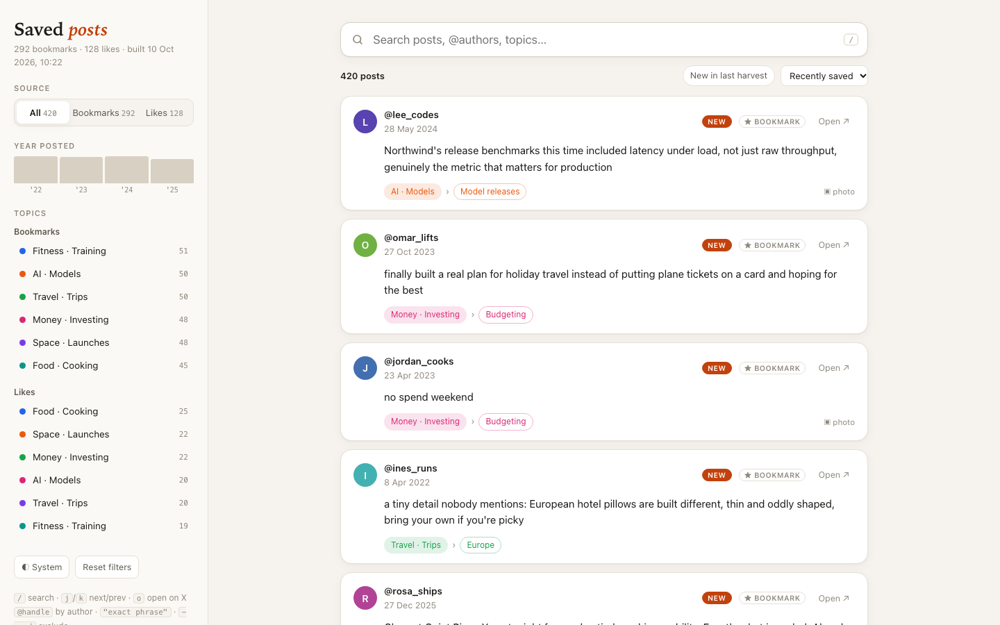
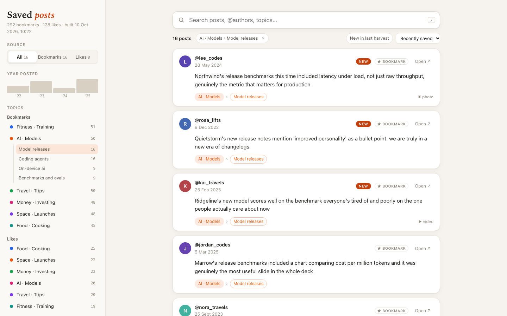
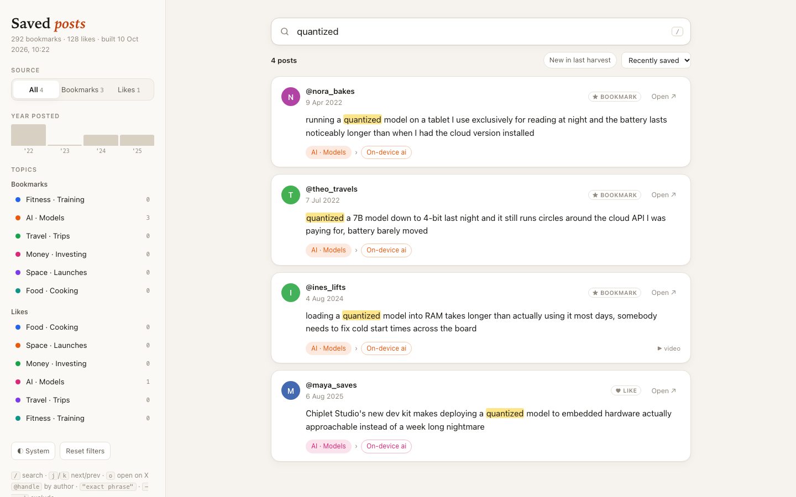
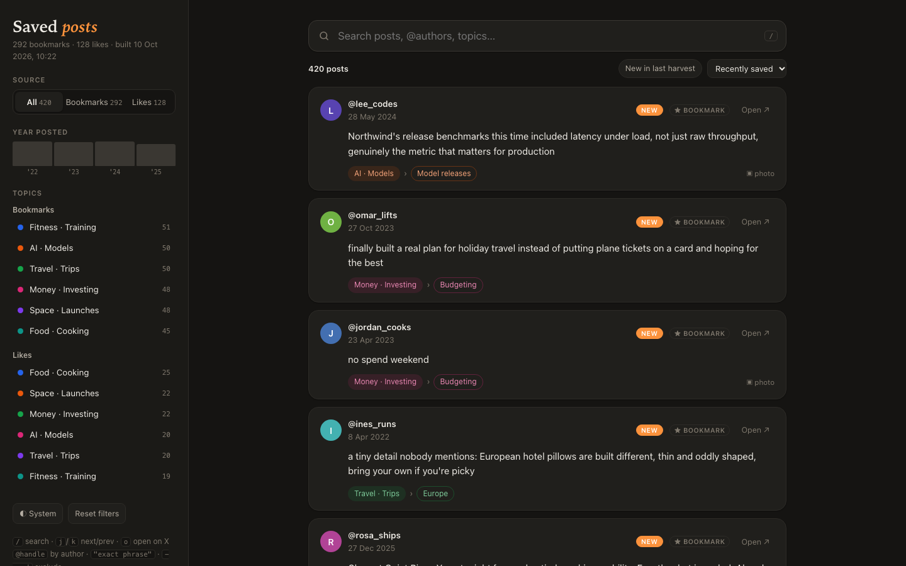
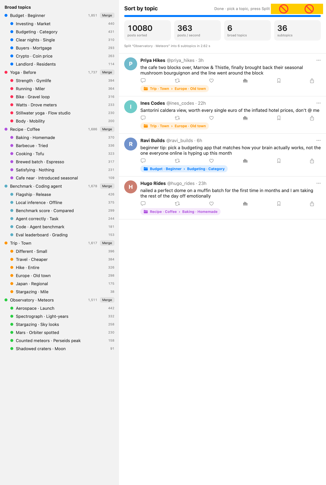

# twitter-bookmarks

Download your X (Twitter) **bookmarks** and **likes**, sort them into topics **entirely on-device** with
[EmbeddingGemma 2 on the Apple Neural Engine](https://huggingface.co/FluidInference/embeddinggemma-2-coreml), and
browse everything in one fast, self-contained HTML page.

- **No API key, no cookies, no scraping service.** Posts are read from your own logged-in Chrome window through the
  macOS Accessibility API.
- **Nothing leaves your machine.** Embedding and clustering run locally via
  [FluidUse](https://github.com/FluidInference/FluidUse).
- **Incremental.** Re-running only appends posts it hasn't seen; nothing is ever deleted.



> Screenshots use fictional demo posts from FluidUse's mock dataset, not real bookmarks.

## What you get

**`data/browse.html`**: one offline page with full-text search, filters by source / year / topic / subtopic, a
"new in last harvest" toggle, light/dark themes, and keyboard navigation.

| Drill into a topic › subtopic | Search with highlighting |
|---|---|
|  |  |

| Dark theme | The sorter app (EmbeddingGemma 2 on the Neural Engine) |
|---|---|
|  |  |

Plus, per source: `data/<source>.topics.md` (a Markdown report grouped by topic → subtopic with links back to X),
`data/<source>.topics.jsonl` (raw assignments) and `data/<source>.topics.png` (a snapshot of the sorter app).

## Requirements

- macOS 15+ on Apple Silicon
- Xcode or the Command Line Tools (Swift 6 toolchain)
- Google Chrome, logged in to x.com
- Accessibility permission for your terminal app
  (System Settings → Privacy & Security → Accessibility), and permission for the terminal to control Chrome
  (prompted on first run)
- Python 3 (standard library only)

## Quick start

```bash
git clone https://github.com/bsbarkur/twitter-bookmarks.git
cd twitter-bookmarks

scripts/build.sh                 # 1. clone FluidUse into vendor/ and build the harvester + sorter (release)
scripts/harvest.sh bookmarks     # 2. x.com/i/history → data/bookmarks.jsonl (auto-scrolls, resumable)
scripts/harvest.sh likes         #    x.com/i/history/likes → data/likes.jsonl
scripts/sort.sh bookmarks 8      # 3. 8 topics, each split into subtopics → data/bookmarks.topics.{jsonl,md,png}
scripts/sort.sh likes 6
open data/browse.html            # 4. browse
```

The first `sort.sh` run downloads the model (~530–800 MB) and compiles it for the Neural Engine once (a few minutes).
After that the model loads in seconds.

### Keeping it up to date

```bash
scripts/update.sh
```

One command: harvests new bookmarks and likes (stops ~30 s after the last new post), re-sorts the full set (topic
names may shift as it grows), rebuilds the page and opens it. Posts from the latest harvest get a **New** badge.

To rebuild only the page: `python3 scripts/browse.py`.

## Using the browse page

| Key / syntax | Action |
|---|---|
| `/` | focus search |
| `j` / `k` | next / previous post |
| `o` | open the selected post on X |
| `@handle` | posts by an author |
| `"exact phrase"` | phrase match |
| `-word` | exclude a word |

Filters are kept in the URL hash, so a filtered view can be bookmarked.

## How it works

```
Chrome (logged in to X)
   │  macOS Accessibility API
   ▼
scripts/xharvest.swift ──► data/<source>.jsonl          one post per line: id, author, createdAt, text, media, harvestedAt
   │
   ▼
FluidUse TopicSortDemo ──► data/<source>.topics.jsonl   EmbeddingGemma 2 on the ANE → topics → subtopics
   │
   ├─► scripts/report.py ──► data/<source>.topics.md
   └─► scripts/browse.py ──► data/browse.html            scripts/browse.template.html + inlined data
```

| File | Purpose |
|---|---|
| `scripts/build.sh` | Clones and builds FluidUse (`BookmarkSortCheck`, `TopicSortDemo`) and compiles `xharvest` |
| `scripts/xharvest.swift` | Reads posts from the Chrome window showing a given X URL, scrolls, dedupes, appends JSONL |
| `scripts/harvest.sh` | Opens the X page in a new Chrome window and runs `xharvest` |
| `scripts/sort.sh` | Runs the on-device topic sorter, then writes the report and page |
| `scripts/report.py` | Joins posts and topic assignments into a Markdown report |
| `scripts/browse.py` / `browse.template.html` | Builds the self-contained browse page |
| `scripts/update.sh` | Harvest + sort + open in one go |

`vendor/` (FluidUse checkout, build output) and `data/` (your posts) are gitignored.

## Tips and troubleshooting

- **Keep the Chrome window visible while harvesting.** Chrome stops loading more posts in minimised or fully
  covered windows. Other X windows can stay open; `xharvest` reads only the window showing the target URL.
- **Harvest stopped early?** Run it again: it resumes and skips posts it already has.
- **Sorter log** (including posts/s): `$TMPDIR/topic-sort-demo.log`. The sorter app stays open after writing its
  output; quit it when you're done.
- **`swift build` fails with `Package.__allocating_init` or `redefinition of module 'SwiftBridging'`?** Leftover
  files from an older Command Line Tools install. `build.sh` detects this and works around it without sudo
  (a patched copy of SwiftPM's libs + a VFS overlay in `vendor/swiftpm-libs`). Reinstalling the CLT is the real fix.

## Performance (M4 Max, macOS 15.6.1)

| | 10,080 mock posts | 2,225 real bookmarks |
|---|---|---|
| Embedding, packed 8 per call | 553 posts/s | |
| End to end (embed + file + re-sort) | 363 posts/s (49 s total) | 222 posts/s (~10 s) |
| Packed vs single embedding agreement | cos min 0.998, mean 0.99986 | |
| Split a topic into subtopics | 2.4–3.3 s | 0.03–0.55 s |

Harvesting 2,225 bookmarks (2019 to today) took ~15 min of auto-scroll.

## Credits

- [FluidUse](https://github.com/FluidInference/FluidUse) by FluidInference: the topic sorter and Neural Engine
  runtime. `xharvest.swift` follows the post parsing of its `BookmarkSortCheck --harvest` (Apache-2.0).
- [EmbeddingGemma 2 (Core ML)](https://huggingface.co/FluidInference/embeddinggemma-2-coreml).
